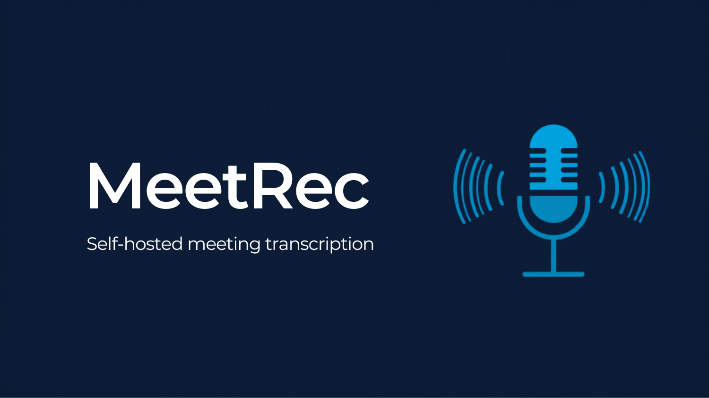

<div align="center">



# MeetRec

**The self-hosted meeting transcription platform that keeps your conversations private.**

[](https://python.org)
[](https://fastapi.tiangolo.com)
[](https://react.dev)
[](https://typescriptlang.org)
[](https://postgresql.org)
[](https://docker.com)
[](LICENSE)

*Drop an audio file. Get a searchable, exportable transcript in minutes.
Everything runs on your infrastructure — no cloud, no subscriptions, no data leaving your premises.*

[Quick Start](#quick-start) · [Features](#features) · [Architecture](#architecture) · [Configuration](#configuration) · [API Reference](#rest-api)

</div>

---

## Why MeetRec?

Every major transcription service — Otter.ai, Fireflies, Zoom AI — sends your recordings to someone else's cloud. For legal teams, medical staff, government agencies, and any organization that handles sensitive conversations, that is a non-starter.

MeetRec runs **entirely on your own server**, including on air-gapped networks with no internet access. Transcription is powered by [WhisperX](https://github.com/m-bain/whisperX) (faster-whisper / CTranslate2) running locally on the CPU, with word-level alignment and optional speaker identification. No audio, no text, no metadata ever leaves your infrastructure.

| | MeetRec | Cloud services |
|---|---|---|
| **Data location** | Your server only | Third-party cloud |
| **Cost** | One-time infrastructure | Per-minute or per-seat subscription |
| **GDPR / compliance** | Full control | Dependent on vendor |
| **Air-gapped deployment** | ✅ Yes | ❌ No |
| **Custom retention policies** | ✅ Yes | Limited |
| **Semantic search** | ✅ Built-in | Usually paid add-on |
| **Tamper-proof audit log** | ✅ Built-in | Varies |

---

## Features

### Core

- **Automatic transcription** — WhisperX with the Whisper `large-v3` or `large-v3-turbo` model, Romanian word-level alignment (wav2vec2), all CPU cores; drop a file in `/data/inbox` and transcription starts immediately
- **Reliable job queue** — a transcription interrupted by a crash or restart is resumed automatically; a file that repeatedly crashes the worker is marked failed instead of blocking the queue
- **Web upload** — drag-and-drop interface with real-time progress; supports MP3, MP4, WAV, M4A, OGG, FLAC, WEBM
- **Recording in the browser (beta)** — record a meeting straight from the web app with any microphone connected to the computer; audio is sent to the server every 5 minutes while the meeting is still running, and transcription starts as soon as the recording is stopped (see [Recording meetings](#recording-meetings-beta))
- **Synchronized audio player** — click any transcript segment to jump to that exact moment in the recording
- **Virtual scrolling** — renders thousands of transcript segments without lag using `@tanstack/react-virtual`
- **Multi-segment session recording** — long meetings are split into 5-minute WAV segments, each uploaded with a shared `session_id`; the server assembles all segments before transcription so Whisper has full context at junctions; session duration is derived from ingest-measured audio durations (not Whisper timestamps)
- **Full merged-audio playback** — after transcription, the assembled WAV is stored permanently so the audio player can play the complete recording, not just the first segment
- **Modern UI** — complete frontend redesign with Inter font, indigo primary color system, dark slate sidebar, animated toasts, and polished card/badge/button components

### Speaker Diarization (optional)

- **pyannote.audio** — tags each segment with a speaker (shown as *Speaker 1*, *Speaker 2*, …); runs **in parallel** with transcription by default, splitting the CPU cores between the two
- **Speaker-to-participant mapping** — after transcription, an admin or operator assigns speakers to known participants from the recording page; names appear across the transcript, in search results and in exports
- Switched on/off (and min/max speakers) from **Admin → Settings** without editing `.env`; the worker reloads its models by itself when idle
- Requires a HuggingFace token (`HF_TOKEN`) and acceptance of the pyannote model terms **only on the build machine**, to download the model before it is baked into the image

### Search

- **One search box, two engines** — exact (full-text) and semantic results are merged with Reciprocal Rank Fusion and grouped by meeting, with pagination
- **Full-text** — PostgreSQL `TSVECTOR` + GIN with a Romanian stemmer, **diacritics optional** (`sedinta` finds `ședința`, and vice versa); syntax: `"exact phrase"`, `budget OR funds`, `-excluded`; natural-language questions match any of their terms
- **Semantic** — multilingual Sentence Transformers embeddings + pgvector HNSW; each segment is embedded together with its neighbours for context; finds related content even when the words differ
- **Meeting metadata** — titles, descriptions, locations and participant lists are searched too
- **Filters** — date range, location, minimum duration, speaker
- **Jump to the moment** — clicking a result opens the recording and starts the audio at that fragment
- If the semantic engine is unavailable, the page says so and still shows exact matches

### Export & Integration

- **PDF** — formatted document with title, metadata, timestamps, speakers and full transcript (Romanian diacritics included)
- **DOCX** — Word-compatible file with headings, timestamps and speakers
- **TXT** — plain text with timestamps and speakers; easy to pipe into other tools
- **REST API** — full OpenAPI 3.0 spec; every feature available programmatically

### Security & Compliance

- **JWT authentication** (HS256) with configurable expiry; forced password change on first login
- **Role-based access control** — `admin`, `operator`, `participant` roles with granular permissions
- **Participant linking** — explicitly grant access to individual recordings per user
- **bcrypt** password hashing at cost factor 12
- **Brute-force protection** — 5 login attempts/min per IP, and an account is locked for 15 minutes after 5 consecutive failures
- **Rate limiting** — search 30–60 req/min, export 20 req/hour, per client IP (taken from nginx only from trusted proxies)
- **Detailed audit log** — logins (successful and failed), uploads, views, searches, exports, edits and deletions, with user, IP and timestamp; stores the **resource name at the time of the action** (still readable after deletion) and **what changed** (e.g. *role: operator → administrator*); searchable, filterable, CSV export
- **Tamper-proof audit trail** — a database trigger rejects any `UPDATE`, `DELETE` or `TRUNCATE` on the audit log, except retention purges of entries older than one year
- **Auto-retention** — recordings are deleted automatically N days after upload, audit entries after M days; checked daily
- **Path traversal protection** — all file operations validated with `pathlib.Path.resolve()`
- **File validation** — type verified by magic bytes, not just extension; SHA-256 deduplication prevents duplicate uploads
- **CORS** restricted to explicit origins in production

### Administration

- **Settings** — operational settings (diarization, retention, file size limit, job attempts, stuck-job timeouts) changed from the UI; the UI value overrides `.env`, every change is audited
- **System status** — version, transcription worker (model, threads, current job), queue length, free disk space, semantic index progress, recordings by status, recent failures
- **Processing times** — how long each transcription took, its ratio to the audio duration, and the time per stage (transcription, alignment, diarization); sortable by newest or slowest
- **Users** — create, edit, deactivate, reset passwords, roles

---

## Recording meetings (beta)

> Browser recording is new in 1.1 and still being tested. For important meetings, keep a backup recording (voice recorder or phone) that can be uploaded with **Upload file**.

Meetings are recorded **in the browser**, from the **Record** menu item. No software has to be installed on the room computer: a browser opened on the MeetRec address is enough.

1. Fill in the meeting details (title, date, location, participants).
2. **Enable the microphone**, pick it from the list and check that the level bar moves when someone speaks.
3. **Start recording.** Every 5 minutes, the audio recorded so far is sent to the server as a WAV segment (16 kHz mono, ~10 MB). The application can be used normally in the meantime; the sidebar shows the recording time.
4. **Stop and send to transcription.** The last segment is sent and transcription starts immediately.

How it behaves when something goes wrong:

| Situation | Behaviour |
|---|---|
| Network or server down during the meeting | Recording continues; segments are kept in the browser and re-sent automatically. An outage longer than `SESSION_TIMEOUT_SECONDS` (30 min) lets the server start transcribing the part received so far |
| Microphone unplugged | Recording stops and everything recorded so far is sent to transcription |
| Browser closed by mistake | The browser asks for confirmation first. If it is closed anyway, the segments already sent (all but at most the last 5 minutes) are transcribed automatically after 30 minutes |
| Long meeting (past the 8-hour login expiry) | The login token is renewed every 30 minutes while recording |
| Computer going to sleep | Prevented while recording, where the browser supports it (Screen Wake Lock); otherwise disable sleep on the room computer |

Requirements:

- **HTTPS.** Browsers only allow microphone access on secure pages. The client computer must trust the server certificate (import `meetrec-ca.crt`, see the [installation guides](docs/INSTALL-OFFLINE.md#6-certificate-https-și-configurarea-clienților)).
- **Role.** Recording is available to administrators and operators, like file upload.
- **Browser.** Current Chrome, Edge or Firefox.

**Recommended hardware:**

| Room | Microphone |
|---|---|
| Small (4–8 people, one table) | USB speakerphone in the middle of the table, e.g. Jabra Speak 510 (~€100) / Speak 750 (~€200) |
| Medium (8–15 people) | Two linked speakerphones (Jabra Speak 750) or a ceiling / bar microphone |
| Council chamber with desk microphones | No new microphones: connect the record output of the existing sound system or mixer to a USB audio interface (e.g. Behringer UMC202HD, Focusrite Scarlett Solo); every speaker is already close to a microphone, which gives the best transcription |

A built-in laptop microphone works for small meetings, but noticeably lowers transcription accuracy and speaker identification for anyone sitting more than 1–2 m away.

---

## Architecture

MeetRec is composed of six independent services that communicate through PostgreSQL and Redis. Each service has a single responsibility and can be scaled independently.

```
Browser                     Drop folder
    │                          │
    │ POST /api/v1/inbox/upload │ cp meeting.mp3 data/inbox/
    │ (file upload, or 5-minute │
    │  segments while recording)│
    ▼                          ▼
┌─────────────────────────────────────────────┐
│                   Nginx                     │  ← Reverse proxy + static assets
└──────────────┬──────────────────────────────┘
               │
               ▼
┌──────────────────────────┐
│         FastAPI          │  ← REST API: auth · CRUD · search · export · audit
└──────┬───────────────────┘
       │ writes audio to /data/inbox/
       ▼
┌──────────────────────────┐
│      Ingest Service      │  ← watchdog: detect → validate → deduplicate → queue
│  (format · size ·        │     + Session Watcher: assembles multi-segment sessions
│   duration · SHA-256)    │     → dispatches on timeout or /complete signal
└──────┬───────────────────┘
       │ LPUSH job
       ▼
┌──────────────────────────┐
│         Redis            │  ← Reliable job queue (processing list per worker)
└──────┬───────────────────┘
       │ BLMOVE job
       ▼
┌──────────────────────────┐     ┌───────────────────────┐
│      STT Worker          │────►│   Search Indexer      │
│  (WhisperX: transcribe · │     │  (Sentence Transformers│
│   align · diarize)       │     │   + pgvector HNSW)    │
│  stores merged WAV       │     └──────────┬────────────┘
└──────┬───────────────────┘
       │                                    │
       └──────────────┬─────────────────────┘
                      ▼
           ┌─────────────────────┐
           │    PostgreSQL 15    │  ← Storage · FTS · vector search
           │  + pgvector ext.    │
           └─────────────────────┘
                      ▲
           ┌─────────────────────┐
           │  Audit Retention    │  ← Retention · stuck jobs · GDPR delete
           └─────────────────────┘
```

**Design principle:** the Ingest Service is the only entry point for audio. The API never touches audio files directly. This enforces validation and deduplication regardless of how files arrive (web upload, drop folder, or a meeting recorded in the browser).

**Multi-segment sessions:** a meeting recorded in the browser is registered with `POST /inbox/session/create`, then uploaded as 5-minute WAV chunks tagged with the shared `session_id`. The Ingest Session Watcher monitors open sessions and dispatches transcription after 1800 s of inactivity or when `POST /inbox/session/{id}/complete` is called. The STT Worker then concatenates all segments before running Whisper and stores the merged WAV for full-session audio playback.

### Service summary

| Service | Technology | Responsibility |
|---|---|---|
| **API** | FastAPI + SQLAlchemy async | REST endpoints, JWT auth, business logic |
| **Ingest** | Python watchdog + asyncpg | File detection, validation, SHA-256 dedup, queuing; Session Watcher for multi-segment sessions |
| **STT Worker** | WhisperX (faster-whisper) + pyannote + asyncpg | Audio assembly, speech-to-text, word alignment, speaker diarization, per-stage timings, merged WAV storage |
| **Search Indexer** | Sentence Transformers + pgvector | Semantic embeddings via LISTEN/NOTIFY plus a periodic sweep; re-embeds automatically when the model or context changes |
| **Audit Retention** | asyncio scheduler | Daily retention deletes, stuck-transcription and abandoned-session cleanup |
| **Frontend** | React 18 + Vite + TailwindCSS | SPA: upload, browse, search, export, admin |
| **PostgreSQL** | pgvector/pgvector:pg15 | Relational storage, TSVECTOR FTS, vector search |
| **Redis** | redis:7-alpine | Async job queue between Ingest and STT Worker |
| **Nginx** | nginx:1.25-alpine | Reverse proxy, TLS termination, static file serving |

---

## Quick Start

Pick the installation method that matches your server:

| Target | Command | Guide |
|---|---|---|
| Linux server **with internet** | `bash install/online/install.sh` | [INSTALL-ONLINE.md](docs/INSTALL-ONLINE.md) · [EN](docs/INSTALL-ONLINE.en.md) |
| Windows + Docker Desktop | `.\install\online\install.ps1` | [INSTALL-ONLINE.md](docs/INSTALL-ONLINE.md) · [EN](docs/INSTALL-ONLINE.en.md) |
| Server **without internet** (air-gapped) | build: `bash install/offline/build-bundle.sh` → on server: `sudo ./install-offline.sh` | [INSTALL-OFFLINE.md](docs/INSTALL-OFFLINE.md) |

All scripts live in [`install/`](install/README.md) and are run from the repository root.

### Windows (recommended)

Requirements: [Docker Desktop](https://www.docker.com/products/docker-desktop/), [Git for Windows](https://git-scm.com).

```powershell
git clone https://github.com/StefanJoita/MeetRec.git
cd MeetRec
.\install\online\install.ps1
```

> If PowerShell blocks the script, run once: `Set-ExecutionPolicy -Scope CurrentUser RemoteSigned`

### Linux (Ubuntu/Debian)

```bash
git clone https://github.com/StefanJoita/MeetRec.git
cd MeetRec
bash install/online/install.sh
```

Both installers handle everything: Docker check, `.env` generation, SSL certificates, Docker build, service startup, and admin account creation.

### Manual / other platforms

```bash
# 1. Clone
git clone https://github.com/StefanJoita/MeetRec.git
cd MeetRec

# 2. Configure
cp .env.example .env
# Edit .env: set JWT_SECRET_KEY (min 32 chars), POSTGRES_PASSWORD, REDIS_PASSWORD, SERVER_NAME
# (optional) HF_TOKEN for speaker diarization models

# 3. Generate secrets
python -c "import secrets; print(secrets.token_hex(32))"

# 3b. Download ML models (baked into the images at build time; needs Docker + internet)
bash install/models/download-models-docker.sh            # add --skip-diarization without HF_TOKEN

# 4. SSL certificates
bash install/certs/gen-self-signed.sh localhost

# 5. Create data directories
mkdir -p data/inbox data/processed data/exports

# 6. Start
docker compose up --build -d

# 7. Create admin account
make create-admin

# 8. Verify
docker compose exec api curl -s http://localhost:8080/health
# → {"status": "healthy", ...}
```

> **Models are baked into the images** (Whisper `large-v3` or `large-v3-turbo`, Romanian alignment, optional pyannote diarization, embeddings): no download at first start and no internet access at runtime.

| Endpoint | URL |
|---|---|
| Web UI | `https://localhost` |
| API (production) | `https://localhost/api/v1/...` (via nginx; port 8080 is not published) |
| API docs + port 8080 (dev only) | `make dev` → `http://localhost:8080/docs` |

See [`docs/INSTALL-ONLINE.md`](docs/INSTALL-ONLINE.md) (Romanian) or [`docs/INSTALL-ONLINE.en.md`](docs/INSTALL-ONLINE.en.md) (English) for the full installation guide,
and [`docs/INSTALL-OFFLINE.md`](docs/INSTALL-OFFLINE.md) (Romanian) for **air-gapped / offline** deployment.

---

## Usage

### Drop-folder

The simplest way to ingest recordings — no browser required:

```bash
cp board-meeting.mp3 data/inbox/

# Follow progress
docker compose logs -f ingest stt-worker
```

Ingest validates the file (format, size, duration, SHA-256 dedup), adds it to the queue, and the STT Worker picks it up within seconds.

### Web Interface

1. Open `http://localhost` and log in
2. **Record** — record the meeting from the browser; **Upload file** — drag-and-drop or click to upload an existing recording; both take an optional title, description, location, participants
3. Transcription progress updates in real time on the recording page
4. Click any segment in the transcript to seek the audio player to that moment
5. **Speakers** — assign the detected speakers to participants from the recording page
6. **Search** — type a question or keywords and press Enter; results are grouped by meeting, click one to play that moment
7. **Export** — download as PDF, DOCX, or TXT from the recording detail page
8. **Admin** — users, settings, system status, processing times and the audit log

### REST API

The examples use port 8080, published only in development (`make dev`). In production use `https://<server>/api/v1/...`.

```bash
# Authenticate
TOKEN=$(curl -s -X POST http://localhost:8080/api/v1/auth/login \
  -H "Content-Type: application/json" \
  -d '{"username": "admin", "password": "your-password"}' \
  | jq -r '.access_token')

# Upload a recording
curl -X POST http://localhost:8080/api/v1/inbox/upload \
  -H "Authorization: Bearer $TOKEN" \
  -F "file=@meeting.mp3" \
  -F "title=Board Meeting Q1" \
  -F "meeting_date=2026-03-22"
# → 202 Accepted {"message": "...", "filename": "meeting.mp3", ...}  (processed asynchronously by Ingest)

# List recordings
curl -H "Authorization: Bearer $TOKEN" \
  "http://localhost:8080/api/v1/recordings?page=1&page_size=20"

# Combined search (exact + semantic, grouped by meeting) — what the UI uses
curl -H "Authorization: Bearer $TOKEN" \
  "http://localhost:8080/api/v1/search/combined?q=budget+2026&page=1"

# Exact (full-text) only — supports "phrases", OR, -exclusion
curl -H "Authorization: Bearer $TOKEN" \
  "http://localhost:8080/api/v1/search/?q=%22vot+de+investitura%22"

# Semantic only
curl -H "Authorization: Bearer $TOKEN" \
  "http://localhost:8080/api/v1/search/semantic?q=cost+reduction+strategy"

# Export as PDF
curl -H "Authorization: Bearer $TOKEN" \
  "http://localhost:8080/api/v1/export/recording/{id}?format=pdf" \
  --output transcript.pdf
```

Full OpenAPI specification available at `/docs` when `APP_ENV=development`.

---

## Configuration

All settings are read from `.env`. Copy `.env.example` to get started.

### Required

| Variable | Description |
|---|---|
| `JWT_SECRET_KEY` | Signing key — **minimum 32 characters, cryptographically random** |
| `POSTGRES_PASSWORD` | PostgreSQL password |
| `DATABASE_URL` | `postgresql+asyncpg://mt_user:<password>@postgres:5432/meeting_transcriber` |
| `REDIS_PASSWORD` | Redis password (URL-safe, e.g. `openssl rand -hex 24`) |

### Whisper model sizes

| Model | Size | Speed | Accuracy |
|---|---|---|---|
| `tiny` | 75 MB | Fastest | Basic |
| `base` | 145 MB | Fast | Good |
| `small` | 465 MB | Moderate | Better |
| `medium` | 1.5 GB | Moderate | Good balance |
| `large-v3` | 2.9 GB | Slow | **Default** — best accuracy |
| `large-v3-turbo` | 1.6 GB | Several times faster than `large-v3` on CPU | Close to `large-v3`; recommended for CPU servers |

Set with `WHISPER_MODEL=large-v3` in `.env`. Only that model is baked into the `stt-worker` image (tagged
`meetrec/stt-worker:<version>-<model>`), so changing it requires `install/models/download-models.py --whisper-model <name>`
and rebuilding `stt-worker`. Several models can sit side by side in `services/stt-worker/models/whisper/` — e.g. `small`
for development on a laptop and `large-v3` for production. The offline bundle uses `large-v3` unless
`WHISPER_MODEL` is set explicitly when running `build-bundle.sh` (e.g. `WHISPER_MODEL=large-v3-turbo`).

Reference measurement (CPU, `large-v3-turbo`, diarization in parallel): 3 min 42 s of audio processed in 4 min 36 s — transcription 2 min 34 s, diarization 4 min 25 s. Real timings for every recording are shown in **Admin → Processing times**.

### Key optional settings

Settings marked ✱ can also be changed from **Admin → Settings**; the UI value overrides `.env`.

| Variable | Default | Description |
|---|---|---|
| `WHISPER_MODEL` | `large-v3` | Whisper model (must match the model baked into the image) |
| `WHISPER_THREADS` | `0` (all cores) | CPU threads for transcription; halved automatically while diarization runs in parallel |
| `DIARIZATION_ENABLED` ✱ | `false` | Speaker identification (requires the pyannote model in the image) |
| `DIARIZATION_PARALLEL` ✱ | `true` | Run diarization in parallel with transcription |
| `MIN_SPEAKERS` / `MAX_SPEAKERS` ✱ | _(empty)_ | Hints for diarization |
| `MAX_JOB_ATTEMPTS` ✱ | `2` | Crashes allowed on the same file before it is marked failed |
| `RETENTION_DAYS` ✱ | `1095` | Delete recordings N days after upload (3 years) |
| `AUDIT_LOG_RETENTION_DAYS` ✱ | `2190` | Audit log retention (6 years, minimum 1 year) |
| `MAX_FILE_SIZE_BYTES` ✱ | `524288000` | Max upload size (500 MB) |
| `EMBEDDING_CONTEXT_SEGMENTS` | `1` | Neighbouring segments included in each semantic embedding; changing it re-embeds everything in the background |
| `SESSION_TIMEOUT_SECONDS` | `1800` | Inactivity timeout before an open multi-segment session is auto-dispatched |
| `HF_TOKEN` | _(empty)_ | HuggingFace token — build machine only, for downloading the pyannote diarization model |
| `MEETREC_VERSION` | `1.2.0` | Tag of the `meetrec/*` images |
| `APP_ENV` | `production` | `development` enables `/docs` |

---

## Hardware

MeetRec is built and tested for **CPU-only** servers: the images ship the CPU build of PyTorch and the worker runs on the CPU. GPU acceleration is not supported out of the box (it would require a CUDA image and code changes).

Recommended: 8+ cores, 32 GB RAM (16 GB minimum with `large-v3` and diarization). See the [offline guide](docs/INSTALL-OFFLINE.md#1-cerințe) for details.

---

## Testing

### Backend

Tests run inside Docker containers using `pytest` + `pytest-asyncio`. The API test suite uses `httpx.AsyncClient` with `ASGITransport` (in-memory, no real server needed).

```bash
# Run all backend tests
make test

# Per-service
docker compose exec api pytest tests/ -v
docker compose exec ingest pytest tests/ -v
docker compose exec stt-worker pytest tests/ -v
docker compose exec audit-retention pytest tests/ -v

# search-indexer: tests are not copied into the image — mount the sources
docker run --rm -v "$PWD/services/search-indexer:/app" -w /app --entrypoint python \
  meetrec/search-indexer:<version> -m pytest

# Single file or test
docker compose exec api pytest tests/test_recordings.py -v
docker compose exec api pytest tests/ -k "test_health" -v
```

### Frontend

Frontend tests use [Vitest](https://vitest.dev) + Testing Library in a jsdom environment.

```bash
# Single run
make frontend-test

# Watch mode (interactive)
docker compose exec frontend npm run test:watch

# Coverage report
docker compose exec frontend npm run test:coverage
```

---

## Security

MeetRec is built for organizations where data privacy is non-negotiable.

- Audio files never leave your server — Whisper runs fully on-premise
- All API endpoints require a valid JWT; tokens expire and can be revoked
- Role-based access control with three tiers: `admin`, `operator`, `participant`
- Participant-level access allows granting specific users access to individual recordings only
- Every user action is audit-logged with IP, timestamp, user identity, resource name and what changed — suitable for legal and compliance evidence; the database refuses to modify or delete audit entries (except retention purges older than one year)
- Failed logins are logged and accounts are locked after repeated failures
- Configurable retention: recordings are automatically and permanently deleted after your specified period
- Content-Security-Policy headers set by Nginx in production
- File uploads validated by magic bytes before any processing occurs

> Set `APP_ENV=production` before any public-facing deployment. Never expose the development API docs in production.

---

## Project Structure

```
MeetRec/
├── services/
│   ├── api/                    # FastAPI application
│   │   ├── src/
│   │   │   ├── routers/        # auth · recordings · transcript · search · export · users · inbox · admin · audit
│   │   │   ├── services/       # recording · transcript · search · user · app_settings · audit_describe
│   │   │   ├── models/         # SQLAlchemy ORM models
│   │   │   ├── schemas/        # Pydantic request/response schemas
│   │   │   └── middleware/     # JWT auth · audit logging · rate limiting
│   │   └── alembic/            # Database migrations (001–013)
│   ├── ingest/                 # File watcher, validator, queue producer
│   ├── stt-worker/             # WhisperX transcription + diarization worker
│   ├── search-indexer/         # Sentence Transformers + pgvector indexer
│   └── audit-retention/        # Scheduled cleanup service
├── frontend/
│   └── src/
│       ├── pages/              # RecordingsList · Detail · NewRecording · Search · Admin · Login
│       ├── components/         # AudioPlayer · TranscriptViewer · ParticipantLinker · SpeakerMappingEditor · admin/
│       ├── api/                # Typed axios client with JWT interceptors
│       └── contexts/           # AuthContext · ToastContext
├── install/                    # see install/README.md
│   ├── online/                 # install.sh (Linux) · install.ps1 (Windows)
│   ├── offline/                # build-bundle.sh · install-offline.sh · download-*-packages.sh
│   ├── models/                 # download-models.py · download-models-docker.sh
│   └── certs/                  # gen-local-ca.sh · gen-self-signed.sh · gen-letsencrypt.sh
├── docs/
│   ├── INSTALL-ONLINE.md       # Online installation guide (Romanian)
│   ├── INSTALL-ONLINE.en.md    # Online installation guide (English)
│   └── INSTALL-OFFLINE.md      # Air-gapped installation guide (Romanian)
├── database/
│   └── init.sql                # Base schema with indexes and pgvector
├── nginx/                      # Reverse proxy config + SSL
├── docker-compose.yml
└── .env.example
```

---

## Implementation Status

| Component | Status |
|---|---|
| Ingest Service (format · size · duration · SHA-256 dedup) | ✅ Complete |
| STT Worker (WhisperX, reliable queue, crash recovery) | ✅ Complete |
| API — auth, CRUD, search, export, audit | ✅ Complete |
| Role-based access control (admin / operator / participant) | ✅ Complete |
| Participant-level recording access | ✅ Complete |
| Frontend — upload, list, detail, search, admin | ✅ Complete |
| Real-time transcription progress | ✅ Complete |
| Synchronized audio + transcript player | ✅ Complete |
| Full-text search (TSVECTOR + GIN, Romanian, diacritics-insensitive) | ✅ Complete |
| Semantic search (Sentence Transformers + pgvector HNSW, context-aware) | ✅ Complete |
| Combined search (rank fusion, grouped by meeting, metadata, speaker filter) | ✅ Complete |
| Export — PDF, DOCX, TXT, with speakers | ✅ Complete |
| Detailed, tamper-proof audit log (names, changes, logins, uploads) | ✅ Complete |
| Admin — settings, system status, processing times | ✅ Complete |
| Audit retention & GDPR auto-delete | ✅ Complete |
| Virtual scrolling (1000+ segments) | ✅ Complete |
| Database migrations (001–013) | ✅ Complete |
| Multi-segment session recording (Session Watcher + audio assembly) | ✅ Complete |
| Meeting recording in the browser (AudioWorklet → 5-minute WAV segments, retry, token renewal) | ✅ Complete |
| Full session audio playback (merged WAV stored post-transcription) | ✅ Complete |
| Modern UI redesign (Inter font, indigo palette, dark sidebar, animated toasts) | ✅ Complete |
| `POST /inbox/session/{id}/complete` explicit dispatch endpoint | ✅ Complete |
| Speaker diarization (pyannote, optional, parallel with transcription) | ✅ Complete |
| Speaker-to-participant label mapping UI | ✅ Complete |

---

## License

Proprietary — all rights reserved. Contact the repository owner for licensing inquiries.
